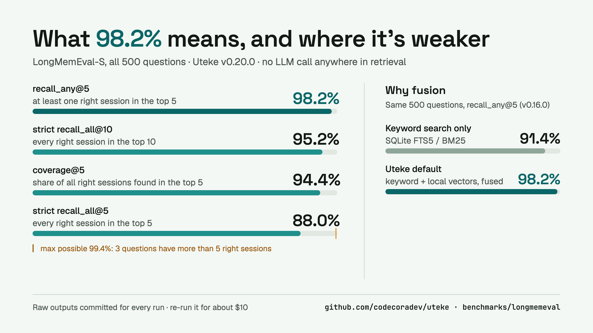
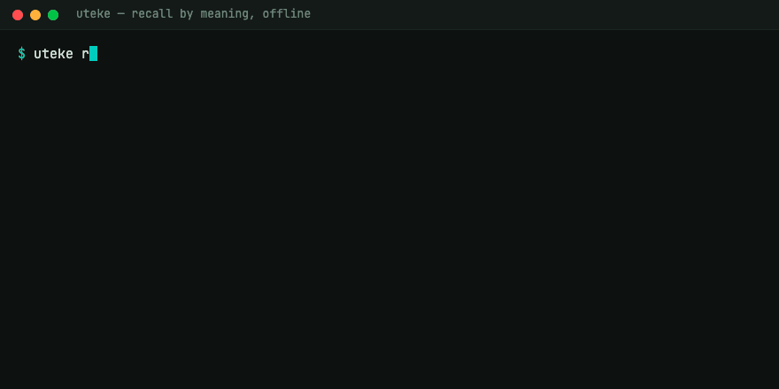
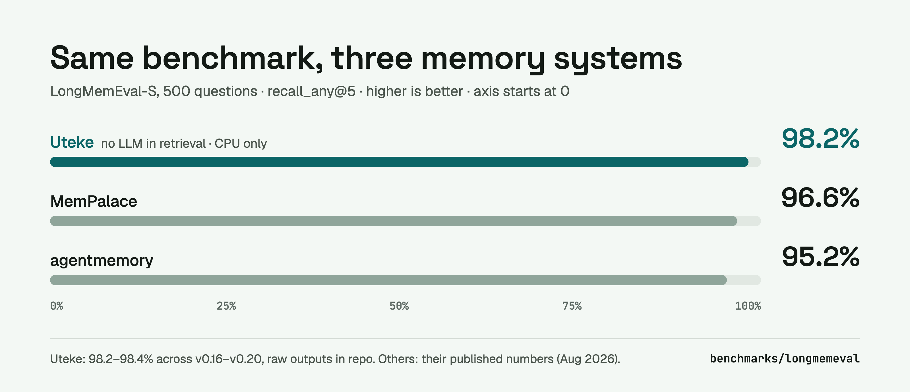
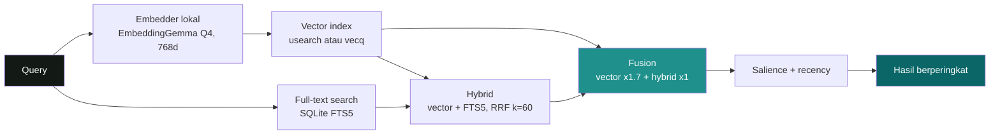

<p align="center">
  
</p>

<h1 align="center">Uteke</h1>

<p align="center">
  <strong>Memori jangka panjang untuk semua agent AI.</strong><br />
  Satu binary Rust, jalan offline, tanpa API key. Self-host gratis, atau biar kami yang host di <a href="https://uteke.app/?utm_source=github-id&utm_medium=readme&utm_campaign=prove-the-recall">Uteke Cloud</a>.
</p>

<p align="center">
  <a href="https://github.com/codecoradev/uteke/actions/workflows/ci.yml?branch=develop"></a>
  <a href="https://github.com/codecoradev/uteke/releases"></a>
  <a href="https://opensource.org/licenses/Apache-2.0"></a>
  <a href="https://github.com/codecoradev/uteke/stargazers"></a>
  <a href="#benchmark"></a>
</p>

<p align="center">
  <a href="#mulai-cepat">Mulai cepat</a> ·
  <a href="#benchmark">Benchmark</a> ·
  <a href="docs/mcp.md">Sambungkan agent</a> ·
  <a href="#dokumentasi">Dokumentasi</a> ·
  <a href="https://uteke.app/?utm_source=github-id&utm_medium=readme&utm_campaign=prove-the-recall">Uteke Cloud</a> ·
  <a href="README.md">English</a>
</p>

<p align="center">
  <a href="benchmarks/longmemeval/RESULTS.md">
    <picture>
      <source media="(prefers-color-scheme: dark)" srcset="docs/assets/longmemeval-breakdown-dark.png" />
      <source media="(prefers-color-scheme: light)" srcset="docs/assets/longmemeval-breakdown-light.png" />
      
    </picture>
  </a>
</p>

<p align="center">
  <i>Semua 500 pertanyaan LongMemEval-S, tanpa panggilan LLM di retrieval. Raw output-nya ada di repo: <a href="benchmarks/longmemeval/REPRODUCING.md">cek dalam semenit, atau jalankan ulang semuanya dengan sekitar $10</a>.</i>
</p>

---

## Kenapa Uteke

Hari Senin kamu kasih tahu agent cara kamu deploy. Hari Kamis dia sudah lupa. Tiap sesi mulai dari nol, dan tiap agent cuma punya setengah ingatan masing-masing.

Uteke kasih mereka semua satu memori jangka panjang yang jalan di mesin kamu sendiri:

- **Recall yang bisa dicek.** [98,2% recall@5 di LongMemEval-S](#benchmark), angka yang lebih ketat ditampilkan di sebelahnya, dan raw output-nya ada di repo ini.
- **Cepat dan murah.** Recall hangat ~45 ms, 0 token LLM per query, cukup CPU.
- **Satu binary.** Tanpa Python, tanpa Docker, tanpa vector database, tanpa API key. Model embedding (~200 MB) diunduh sekali.
- **Satu memori, semua agent.** Claude Code, Claude Desktop, Cursor, Codex, Hermes, dan klien MCP lain berbagi store yang sama. [Rooms](docs/rooms.md) mencatat agent atau orang mana yang menulis apa.
- **Cari berdasarkan makna dan kata kunci.** Vector lokal dan full-text search SQLite, digabung jadi satu ranking ([cara kerjanya](#cara-kerja)).
- **Ingat lintas waktu.** Recall per titik waktu (`--at`), relationship graph, document engine, dan decay untuk memori basi.
- **Privat dari awal.** Tanpa telemetry. Secret seperti API key disamarkan sebelum memori disimpan.
- **Open source.** Apache-2.0, rilis ditandatangani cosign.

---

## Mulai cepat

```bash
# Install (macOS Apple Silicon, Linux; Windows: lihat di bawah)
curl -sSL codecora.dev/uteke/install | sh

# Simpan memori
uteke remember "Deploy v2.1 ke staging jam 3 sore"

# Cari lagi: berdasarkan makna DAN kata kunci
uteke recall "kapan kita deploy?"
```

<p align="center">
  
</p>

Tanpa API key, tanpa Python, tanpa akun cloud. Run pertama mengunduh model embedding (~200 MB, sekali saja).

Kasih agent kamu (Claude Code, Cursor, Hermes) memori yang sama dengan satu baris:

```jsonc
// .mcp.json
{ "mcpServers": { "uteke": { "command": "uteke-mcp" } } }
```

Baru pakai Uteke, atau kamu *adalah* agent AI? Jalankan `uteke onboard`. Dia mendeteksi setup kamu, menanyakan agent yang kamu pakai, lalu menyambungkan semuanya. 📖 [Onboarding](docs/getting-started.md#interactive-onboarding)

Nggak mau menjalankan apa pun di mesin sendiri? **[Uteke Cloud](https://uteke.app/?utm_source=github-id&utm_medium=readme&utm_campaign=prove-the-recall)** menjalankan mesin yang sama untuk kamu: tambahkan satu URL di Claude, login, selesai. Gratis selama open beta.

<details>
<summary>📦 Opsi install lain & Docker</summary>

| Metode | Perintah |
|--------|---------|
| **Homebrew** | `brew install codecoradev/tap/uteke` (macOS Apple Silicon & Linux) |
| **Cargo** | `cargo install uteke-cli` |
| **Docker** | `docker run -d -p 127.0.0.1:8767:8767 -v uteke-data:/data codecoradev/uteke:latest --host 0.0.0.0` |
| **Binary** | [GitHub Releases](https://github.com/codecoradev/uteke/releases) (macOS, Linux, Windows) |
| **Windows (PowerShell)** | `powershell -ExecutionPolicy Bypass -Command "irm https://raw.githubusercontent.com/codecoradev/uteke/main/install.ps1 \| iex"` |

📖 [Panduan install lengkap](INSTALL.md) · [Docs Docker](docs/docker.md)
</details>

---

## Self-host atau Cloud

Mesinnya sama, dua cara menjalankannya.

| | **Self-host** (repo ini) | **[Uteke Cloud](https://uteke.app/?utm_source=github-id&utm_medium=readme&utm_campaign=prove-the-recall)** |
|---|---|---|
| Mesin dan recall | Lengkap, tanpa paywall | Mesin yang sama |
| Jalan di | Laptop atau server kamu | Kami yang host |
| Sambungkan agent | `uteke-mcp` di `.mcp.json` | Tambahkan `https://uteke.app/mcp` di Claude, login |
| Data kamu | Nggak pernah keluar dari mesin kamu | Disimpan oleh kami; bisa diekspor kapan saja |
| Harga | Gratis, Apache-2.0 | Gratis selama open beta ([batas](https://uteke.app/pricing?utm_source=github-id&utm_medium=readme&utm_campaign=prove-the-recall)) |

**Pilih self-host** kalau data kamu harus tetap di mesin sendiri, atau kamu mau menjalankan Uteke di infrastruktur sendiri.
**Pilih Cloud** kalau kamu mau satu memori di beberapa perangkat dan agent tanpa mengurus server.

---

## Benchmark

[LongMemEval-S](https://arxiv.org/abs/2410.10813) (ICLR 2025) menyembunyikan fakta yang dibutuhkan agent di antara ~115 sesi chat per pertanyaan, lalu mengecek apakah retrieval bisa menemukannya. 500 pertanyaan yang dikurasi manual, lima kemampuan memori. Uteke menjalankan semuanya dengan **nol panggilan LLM di jalur retrieval**: embedding lokal, satu CPU, deterministik.

| Metrik | Uteke **v0.20.0** | MemPalace¹ | agentmemory¹ |
|---|---|---|---|
| **recall_any@5** (bukti di top 5) | **98,2%** | 96,6% | 95,2% |
| recall_any@10 | 98,8% | — | 98,6% |
| **strict recall_all@5** (semua bukti di top 5) | <b>88,0%</b>² | tidak dipublikasikan | tidak dipublikasikan³ |
| Panggilan LLM di retrieval | **0** | — | 0 |

<p align="center">
  <picture>
    <source media="(prefers-color-scheme: dark)" srcset="docs/assets/longmemeval-comparison-dark.png" />
    <source media="(prefers-color-scheme: light)" srcset="docs/assets/longmemeval-comparison-light.png" />
    
  </picture>
</p>

<sub>¹ Angka yang mereka publikasikan di benchmark dan split 500 pertanyaan yang sama, dengan basis recall_any@5 mereka sendiri ([catatan head-to-head](docs/benchmarks.md#head-to-head-vs-published-systems)); setup evaluasinya berbeda. ² Strict = *semua* sesi gold ada di top 5; 65% pertanyaan punya lebih dari satu. Maksimum yang mungkin 99,4%. ³ agentmemory mempublikasikan MRR 88,2%, metrik yang berbeda.</sub>

<details>
<summary>Stabilitas antar rilis dan hasil per jenis pertanyaan</summary>

**Stabil antar rilis** (500 pertanyaan penuh, dihitung dari raw yang di-commit, [RESULTS.md](benchmarks/longmemeval/RESULTS.md#release-stability-full-500-question-basis-scored-from-committed-raw)):

| Rilis | v0.16.0 | v0.17.0 | v0.19.0 | v0.20.0 |
|---|---|---|---|---|
| recall_any@5 | 98,2% | 98,4% | 98,2% | 98,2% |
| strict recall_all@5 | 88,0% | 88,0% | 88,0% | 88,0% |

**Per jenis pertanyaan** (recall_any@5, v0.20.0):

| knowledge-update | single-session | temporal | multi-session |
|:---:|:---:|:---:|:---:|
| **100%** | 96,7–98,2% | 98,4% | 98,3% |

Bukti untuk setiap pertanyaan selalu ada di top 50 (nol yang terlewat). Yang tersisa adalah urutan, saat satu pertanyaan butuh beberapa sesi sekaligus: strict recall_all@5 88,0% dari batas 99,4%, dan sebagian besar kegagalan hanya kehilangan satu sesi.

</details>

> **🎯 Jangan percaya benchmark kami. Jalankan sendiri.** Dataset publik, raw output untuk setiap rilis yang divalidasi, dan skor yang bisa kamu hitung ulang dengan ~20 baris Python. Mengecek hasil yang di-commit cuma butuh semenit tanpa embedder; menjalankan ulang 500 pertanyaan sekitar $10.
> **👉 [benchmarks/longmemeval/REPRODUCING.md](benchmarks/longmemeval/REPRODUCING.md)** · 🧾 [Receipt untuk angka utama (run v0.19.0)](benchmarks/longmemeval/receipts/v0.19.0-default-500q/)

`uteke bench --counts 100,1000,10000` mengukur latency dan throughput di mesin kamu sendiri. 📖 [Docs benchmark](docs/benchmarks.md)

---

## Sambungkan agent kamu

| Klien | Caranya |
|---|---|
| **Claude Code** | `.mcp.json`: `{ "mcpServers": { "uteke": { "command": "uteke-mcp" } } }` · [detail](docs/mcp.md#claude-code) |
| **Claude Desktop** | [contoh config](docs/mcp.md#claude-desktop) |
| **Cursor** | `.mcp.json` yang sama dengan Claude Code · [detail](docs/mcp.md#cursor) |
| **Codex** | `uteke connect codex` memasang hook recall dan capture · [detail](docs/integrations/codex.md) |
| **Hermes** | stdio atau HTTP · [detail](docs/mcp.md#hermes) |
| **Klien MCP lain** | stdio (`uteke-mcp`) atau Streamable HTTP (`uteke-serve`) · [transport](docs/mcp.md#transport-comparison) |
| **Claude di web, desktop, atau mobile** | tambahkan `https://uteke.app/mcp` sebagai connector, login ([Uteke Cloud](https://uteke.app/?utm_source=github-id&utm_medium=readme&utm_campaign=prove-the-recall)) |
| **Tanpa MCP?** | agent apa pun yang bisa menjalankan perintah shell bisa memanggil CLI `uteke` |

<details>
<summary>🏠 Rooms: beberapa agent, satu memori bersama (contoh)</summary>

```bash
# Buat room bersama
uteke room create engineering --title "Keputusan tim"

# Agent milik Alice menyimpan keputusan
uteke remember "Kita pilih Redis untuk caching, bukan Memcached" \
  --room engineering --author alice

# Agent milik Bob menambah konteks
uteke remember "Cluster Redis: 3 node, masing-masing 2 replica" \
  --room engineering --author bob

# Agent mana pun bisa recall riwayat bersama
uteke room recall engineering "keputusan caching"
```

Setiap memori tercatat penulisnya; recall lintas agent tanpa sinkronisasi manual. 📖 [Rooms](docs/rooms.md)
</details>

---

## Fitur

| Memori | Pencarian | Integrasi | Privasi & operasional |
|---|---|---|---|
| Rooms dengan atribusi penulis | Fusion vector + full-text (default) | MCP lewat stdio dan Streamable HTTP | Fully offline, tanpa telemetry |
| Recall per titik waktu (`--at`) | Relationship graph dan auto-link | Server mode dan image Docker | Secret disamarkan sebelum disimpan |
| Tag, entity, tipe memori | Boost salience dan recency | Document engine (`uteke doc`) | Upgrade bertanda tangan (cosign) |
| Partial update dan sitasi | Dream cycle: dedup, backlink, orphan | Batch import, export/import penuh | Dua vector engine (`usearch`, `vecq`) |

Penjelasan lengkap setiap fitur ada di [README bahasa Inggris](README.md#features) dan [dokumentasi](#dokumentasi).

---

## Cara kerja



1. **Vector index** mencari berdasarkan makna ("deploy" cocok dengan "rollout").
2. **FTS5** mencari kata yang persis ("deploy" cocok dengan "deploy").
3. **Hybrid** menggabungkan dua daftar itu dengan Reciprocal Rank Fusion (k=60).
4. **Fusion** menggabungkan ranking vector (bobot 1,7) dengan ranking hybrid (bobot 1), lalu menambah sedikit boost salience dan recency.

Semuanya jalan di dalam proses: tanpa jaringan, tanpa server. `--strategy vector | fts5 | hybrid | graph` memilih satu tahap saja.

<details>
<summary>🐳 Mode deployment</summary>

**Local-first (default)**: satu binary, tanpa infrastruktur. Data kamu tetap di `~/.codecora/uteke/`.

**Docker / server mode**: untuk tim atau agent jarak jauh.

```bash
docker run -d -p 127.0.0.1:8767:8767 -v uteke-data:/data codecoradev/uteke:latest --host 0.0.0.0
# atau tanpa Docker: uteke-serve --port 8767
```

📖 [Setup Docker](docs/docker.md) · [Server mode](docs/configuration.md#server-mode) · [Akses jarak jauh](docs/mcp.md#remote-access-vps--server--domain)
</details>

---

## Dokumentasi

| | |
|---|---|
| **Mulai** | [Instalasi](INSTALL.md) · [Getting started](docs/getting-started.md) · [Onboarding](docs/getting-started.md#interactive-onboarding) |
| **Referensi** | [CLI](docs/cli-reference.md) · [Konfigurasi](docs/configuration.md) · [Docker](docs/docker.md) · [HTTP API](docs/api-reference.md) |
| **Konsep** | [Rooms](docs/rooms.md) · [Mengatur memori](docs/organizing-memories.md) · [Arsitektur](docs/architecture.md) |
| **Integrasi** | [Setup MCP](docs/mcp.md) (Claude Code, Claude Desktop, Cursor, Hermes) · [Hermes](docs/integrations/hermes.md) · Hook [Claude Code](docs/integrations/claude-code.md) / [Codex](docs/integrations/codex.md) / [Cursor](docs/integrations/cursor.md) |
| **Keamanan** | [SECURITY.md](SECURITY.md) (laporan kerentanan, tanda tangan rilis) |
| **Benchmark** | [docs/benchmarks.md](docs/benchmarks.md) · [RESULTS.md](benchmarks/longmemeval/RESULTS.md) · [Jalankan sendiri](benchmarks/longmemeval/REPRODUCING.md) |

Dokumentasi di `docs/` dalam bahasa Inggris.

---

## FAQ

<details>
<summary><strong>"Fully offline", tapi kok ada Uteke Cloud?</strong></summary>

Mesin di repo ini lengkap dan jalan sepenuhnya offline; tidak ada bagian yang memanggil Cloud. Uteke Cloud adalah layanan hosted terpisah dan opsional, menjalankan mesin yang sama untuk orang yang nggak mau menjalankan apa pun di mesinnya, dan datanya bisa diekspor kapan saja. Mesin open source tetap lengkap, dan semua hasil benchmark di atas tidak bergantung pada Cloud.
</details>

<details>
<summary><strong>Kenapa nggak pakai catatan di file Markdown saja?</strong></summary>

File cukup sampai kamu perlu mencari berdasarkan makna: "rilis aplikasinya" nggak akan cocok dengan "deploy v2.1" kalau pakai grep. Uteke mencari berdasarkan makna dan kata kunci sekaligus, mencatat siapa penulis tiap memori, dan bekerja sama untuk semua agent yang kamu pakai, bukan satu file per tool.
</details>

<details>
<summary><strong>Apa bedanya Uteke dengan memory tool yang butuh cloud?</strong></summary>

Banyak memory layer butuh API key cloud (OpenAI atau LLM lain) dan infrastruktur tambahan (Docker, Postgres, Qdrant), dan data kamu dikirim ke penyedia LLM. Uteke satu binary tanpa API key; embedding jalan lokal lewat ONNX.
</details>

<details>
<summary><strong>Beneran jalan offline?</strong></summary>

Ya. Model embedding (EmbeddingGemma Q4, 768d) diunduh sekali (~200 MB) di run pertama. Setelah itu operasi memori tidak memakai jaringan dan tidak ada telemetry. Binary mengecek rilis baru di GitHub sekali sehari; matikan dengan `UTEKE_NO_UPDATE_CHECK=1`. Kalau model lokal gagal, Uteke turun ke no-op embedder; tidak pernah memanggil API cloud.
</details>

<details>
<summary><strong>Seberapa cepat recall-nya?</strong></summary>

~45 ms sebagai CLI (rata-rata 31 ms di 10K memori pada host benchmark yang dipublikasikan; stabil dari 100 sampai 10K memori). Tanpa round-trip jaringan, dan cache LRU melewati embedding ulang untuk query yang berulang.
</details>

<details>
<summary><strong>Sudah siap production?</strong></summary>

Uteke punya 1.300+ test, mutation testing sebelum setiap rilis, CI di setiap pull request, rilis bertanda tangan cosign, dan benchmark harness. Dipakai di production oleh tim CodeCora dan early adopter lain. Masih 0.x (lihat badge rilis), jadi mungkin masih ada yang kasar, tapi intinya stabil.
</details>

---

## Kontribusi

```bash
cargo build --workspace                                # Build
cargo test --workspace                                 # Test
cargo clippy --workspace --all-targets -- -D warnings  # Lint
cargo fmt --all                                        # Format
```

Kontribusi sangat diterima. Baca [CONTRIBUTING.md](CONTRIBUTING.md), atau sapa kami di [Discussions](https://github.com/codecoradev/uteke/discussions).

## Lisensi

[Apache License 2.0](LICENSE). Pakai, fork, kirim.

---

<p align="center">
  <a href="https://www.star-history.com/?repos=codecoradev%2Futeke&type=timeline&legend=top-left">
    <picture>
      <source media="(prefers-color-scheme: dark)" srcset="https://api.star-history.com/chart?repos=codecoradev/uteke&type=timeline&theme=dark&legend=top-left" />
      <source media="(prefers-color-scheme: light)" srcset="https://api.star-history.com/chart?repos=codecoradev/uteke&type=timeline&theme=light&legend=top-left" />
      
    </picture>
  </a>
</p>

<p align="center">
  Kalau Uteke membantu agent kamu mengingat, satu ⭐ membantu orang lain menemukannya.
</p>
