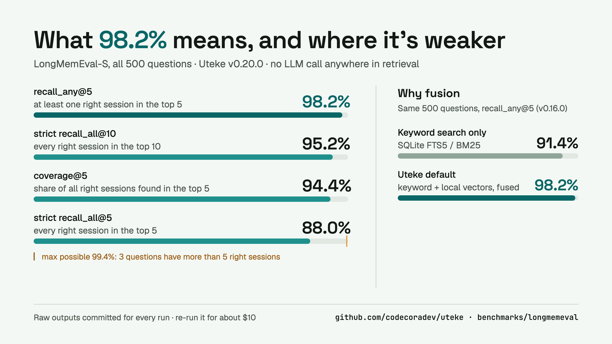
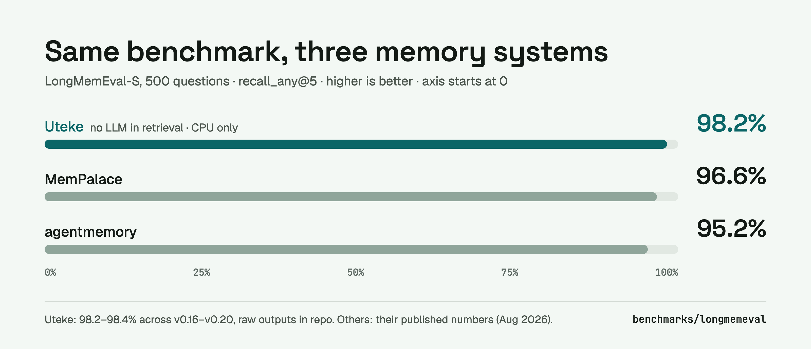
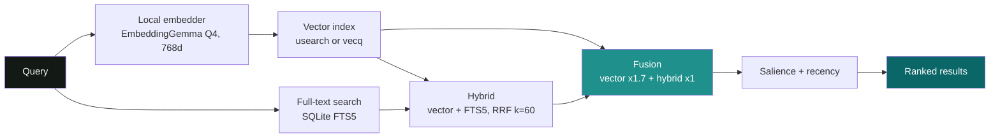

<p align="center">
  
</p>

<h1 align="center">Uteke</h1>

<p align="center">
  <strong>Long-term memory for any AI agent.</strong><br />
  One Rust binary, runs offline, no API key. Self-host it free, or let us host it on <a href="https://uteke.app/?utm_source=github&utm_medium=readme&utm_campaign=prove-the-recall">Uteke Cloud</a>.
</p>

<p align="center">
  <a href="https://github.com/codecoradev/uteke/actions/workflows/ci.yml?branch=develop"></a>
  <a href="https://github.com/codecoradev/uteke/releases"></a>
  <a href="https://opensource.org/licenses/Apache-2.0"></a>
  <a href="https://github.com/codecoradev/uteke/stargazers"></a>
  <a href="#benchmarks"></a>
</p>

<p align="center">
  <a href="#quick-start">Quick start</a> ·
  <a href="#benchmarks">Benchmarks</a> ·
  <a href="docs/mcp.md">Connect your agent</a> ·
  <a href="#documentation">Docs</a> ·
  <a href="https://uteke.app/?utm_source=github&utm_medium=readme&utm_campaign=prove-the-recall">Uteke Cloud</a> ·
  <a href="README.id.md">Bahasa Indonesia</a>
</p>

<p align="center">
  <a href="benchmarks/longmemeval/RESULTS.md">
    <picture>
      <source media="(prefers-color-scheme: dark)" srcset="docs/assets/longmemeval-breakdown-dark.png" />
      <source media="(prefers-color-scheme: light)" srcset="docs/assets/longmemeval-breakdown-light.png" />
      
    </picture>
  </a>
</p>

<p align="center">
  <i>All 500 LongMemEval-S questions, no LLM call in retrieval. Raw outputs are committed: <a href="benchmarks/longmemeval/REPRODUCING.md">check them in a minute, or re-run everything for about $10</a>.</i>
</p>

---

## Why Uteke

On Monday you tell your agent how you deploy. By Thursday it has no idea. Every session starts from zero, and every agent keeps its own half-memory.

Uteke gives all of them one long-term memory that runs on your own machine:

- **Verifiable recall.** [98.2% recall@5 on LongMemEval-S](#benchmarks), with the stricter numbers shown next to it and the raw outputs in this repo.
- **Fast and cheap to query.** ~45 ms warm recall, 0 LLM tokens per query, CPU only.
- **One binary.** No Python, no Docker, no vector database, no API key. The embedding model (~200 MB) downloads once.
- **One memory, every agent.** Claude Code, Claude Desktop, Cursor, Hermes and any MCP client share the same store. [Rooms](docs/rooms.md) record which agent or person wrote what.
- **Finds by meaning and by keyword.** Local vectors and SQLite full-text search, fused into one ranking ([how it works](#how-it-works)).
- **Remembers over time.** Point-in-time recall (`--at`), a relationship graph, a document engine, and decay for stale memories.
- **Private by default.** No telemetry. Secrets such as API keys are masked before a memory is stored.
- **Open source.** Apache-2.0, cosign-signed releases.

---

## Quick start

```bash
# Install (macOS Apple Silicon, Linux; Windows: see below)
curl -sSL codecora.dev/uteke/install | sh

# Store a memory
uteke remember "Deploy v2.1 to staging at 3pm"

# Search it back: by meaning AND by keyword
uteke recall "when do we deploy?"
```

No API keys, no Python, no cloud account. The first run downloads the embedding model (~200 MB, one time).

Give your agent (Claude Code, Cursor, Hermes) the same memory with one line:

```jsonc
// .mcp.json
{ "mcpServers": { "uteke": { "command": "uteke-mcp" } } }
```

New to Uteke, or you *are* an AI agent? Run `uteke onboard`. It detects your setup, asks which agent you use, and wires it up. 📖 [Onboarding](docs/getting-started.md#interactive-onboarding)

Rather not run anything locally? **[Uteke Cloud](https://uteke.app/?utm_source=github&utm_medium=readme&utm_campaign=prove-the-recall)** runs the same engine for you: add one URL to Claude, sign in, done. Free during the open beta.

<details>
<summary>📦 More install options & Docker</summary>

| Method | Command |
|--------|---------|
| **Homebrew** | `brew install codecoradev/tap/uteke` (macOS Apple Silicon & Linux) |
| **Cargo** | `cargo install uteke-cli` |
| **Docker** | `docker run -d -p 127.0.0.1:8767:8767 -v uteke-data:/data codecoradev/uteke:latest --host 0.0.0.0` |
| **Binary** | [GitHub Releases](https://github.com/codecoradev/uteke/releases) (macOS, Linux, Windows) |
| **Windows (PowerShell)** | `powershell -ExecutionPolicy Bypass -Command "irm https://raw.githubusercontent.com/codecoradev/uteke/main/install.ps1 \| iex"` |

📖 [Full install guide](INSTALL.md) · [Docker docs](docs/docker.md)
</details>

---

## Self-host or Cloud

Same engine, two ways to run it.

| | **Self-host** (this repo) | **[Uteke Cloud](https://uteke.app/?utm_source=github&utm_medium=readme&utm_campaign=prove-the-recall)** |
|---|---|---|
| Engine and recall | Full, nothing paywalled | Same engine |
| Runs on | Your laptop or your server | Hosted for you |
| Connect an agent | `uteke-mcp` in `.mcp.json` | Add `https://uteke.app/mcp` to Claude, sign in |
| Your data | Never leaves your machine | Stored by us; export any time |
| Price | Free, Apache-2.0 | Free during the open beta ([limits](https://uteke.app/pricing?utm_source=github&utm_medium=readme&utm_campaign=prove-the-recall)) |

**Choose self-host** if your data must stay on your machine, or you want to run Uteke inside your own infrastructure.
**Choose Cloud** if you want one memory across several devices and agents without running a server.

---

## Benchmarks

[LongMemEval-S](https://arxiv.org/abs/2410.10813) (ICLR 2025) hides the facts an agent needs across ~115 chat sessions per question and checks whether retrieval finds them. 500 hand-curated questions, five memory abilities. Uteke runs the full suite with **zero LLM calls in the retrieval path**: local embeddings, one CPU, deterministic.

| Metric | Uteke **v0.20.0** | MemPalace¹ | agentmemory¹ |
|---|---|---|---|
| **recall_any@5** (evidence in top 5) | **98.2%** | 96.6% | 95.2% |
| recall_any@10 | 98.8% | — | 98.6% |
| **strict recall_all@5** (all evidence in top 5) | <b>88.0%</b>² | not published | not published³ |
| LLM calls in retrieval | **0** | — | 0 |

<p align="center">
  <picture>
    <source media="(prefers-color-scheme: dark)" srcset="docs/assets/longmemeval-comparison-dark.png" />
    <source media="(prefers-color-scheme: light)" srcset="docs/assets/longmemeval-comparison-light.png" />
    
  </picture>
</p>

<sub>¹ Their published numbers on the same benchmark and 500-question split, on their own recall_any@5 basis ([head-to-head notes](docs/benchmarks.md#head-to-head-vs-published-systems)); evaluation setups differ. ² Strict = *every* gold session in the top 5; 65% of questions have more than one. Max possible 99.4%. ³ agentmemory publishes MRR 88.2%, which is a different metric.</sub>

**Stable across releases** (full 500 questions, scored from committed raw, [RESULTS.md](benchmarks/longmemeval/RESULTS.md#four-release-stability-full-500-question-basis-scored-from-committed-raw)):

| Release | v0.16.0 | v0.17.0 | v0.19.0 | v0.20.0 |
|---|---|---|---|---|
| recall_any@5 | 98.2% | 98.4% | 98.2% | 98.2% |
| strict recall_all@5 | 88.0% | 88.0% | 88.0% | 88.0% |

**By question type** (recall_any@5, v0.20.0):

| knowledge-update | single-session | temporal | multi-session |
|:---:|:---:|:---:|:---:|
| **100%** | 96.7–98.2% | 98.4% | 98.3% |

Every question's evidence lands in the top 50 (zero misses). What's left is ordering when a question needs several sessions at once: strict recall_all@5 is 88.0% against a 99.4% ceiling, and most misses lose exactly one session.

> **🎯 Don't trust our benchmark. Run it yourself.** Public dataset, committed raw outputs for every validated release, scoring you can recompute in ~20 lines of Python. Verifying the committed results takes a minute and needs no embedder; re-running all 500 questions costs about $10.
> **👉 [benchmarks/longmemeval/REPRODUCING.md](benchmarks/longmemeval/REPRODUCING.md)** · 🧾 [Receipts for the headline number (v0.19.0 run)](benchmarks/longmemeval/receipts/v0.19.0-default-500q/)

`uteke bench --counts 100,1000,10000` measures latency and throughput on your own machine. 📖 [Benchmark docs](docs/benchmarks.md)

---

## Connect your agent

| Client | How |
|---|---|
| **Claude Code** | `.mcp.json`: `{ "mcpServers": { "uteke": { "command": "uteke-mcp" } } }` · [details](docs/mcp.md#claude-code) |
| **Claude Desktop** | [config snippet](docs/mcp.md#claude-desktop) |
| **Cursor** | same `.mcp.json` as Claude Code · [details](docs/mcp.md#cursor) |
| **Hermes** | stdio or HTTP · [details](docs/mcp.md#hermes) |
| **Any MCP client** | stdio (`uteke-mcp`) or Streamable HTTP (`uteke-serve`) · [transports](docs/mcp.md#transport-comparison) |
| **Claude on the web, desktop or mobile** | add `https://uteke.app/mcp` as a connector, sign in ([Uteke Cloud](https://uteke.app/?utm_source=github&utm_medium=readme&utm_campaign=prove-the-recall)) |
| **No MCP?** | any agent that can run a shell command can call the `uteke` CLI |

<details>
<summary>🏠 Rooms: several agents, one shared memory (example)</summary>

```bash
# Create a shared room
uteke room create engineering --title "Team decisions"

# Alice's agent stores a decision
uteke remember "We chose Redis for caching over Memcached" \
  --room engineering --author alice

# Bob's agent adds context
uteke remember "Redis cluster: 3 nodes, 2 replicas each" \
  --room engineering --author bob

# Any agent can recall the shared history
uteke room recall engineering "caching decision"
```

Author attribution on every memory; cross-agent recall without manual sync. 📖 [Rooms](docs/rooms.md)
</details>

---

## Features

| Memory | Search | Integrations | Privacy & operations |
|---|---|---|---|
| Rooms with author attribution | Fusion of vector + full-text (default) | MCP over stdio and Streamable HTTP | Fully offline, no telemetry |
| Point-in-time recall (`--at`) | Relationship graph and auto-links | Server mode and Docker image | Secrets masked before storage |
| Tags, entities, typed memories | Salience and recency boosts | Document engine (`uteke doc`) | Signed upgrades (cosign) |
| Partial updates and citations | Dream cycle: dedup, backlinks, orphans | Batch import, full export/import | Two vector engines (`usearch`, `vecq`) |

<details>
<summary>All features with details</summary>

### Core memory

| Feature | What it does |
|---------|-------------|
| 🧠 **Hybrid + Fusion Search** | Vector similarity + FTS5 full-text search, merged by Reciprocal Rank Fusion (RRF). Since v0.16.0, `fusion` (a weighted RRF of the vector and hybrid rankings) is the default recall strategy. Finds by meaning AND exact keywords. |
| 🏠 **Rooms** | **Multi-agent shared memory.** Group memories by context (meetings, projects, clients). Multiple agents read/write to the same room with author attribution. Cross-agent recall without manual sync. |
| ⏳ **Time-travel** | Recall memories as they existed at any point in time. `uteke recall "deploy" --at 2025-01-15T00:00:00Z` |
| 🏷️ **Rich Metadata** | Tags, entities, categories, key:value pairs on every memory. |
| 🧩 **Memory Types** | Typed categories (fact, procedure, decision, etc.) with auto-inference. |
| ✏️ **Partial Updates** | `uteke update <id>` changes content, tags, importance, pin or type in place. |
| 📎 **Citations** | Source attribution on every memory (URL, file, user, import batch). |
| 👤 **Author** | Who wrote a memory, with or without a room (`--author`), plus `human` vs `agent` type. |
| 🚫 **Rejected Values** | `uteke forget <id> --reason wrong` records a tombstone: every write path (remember, update, import, supersede) refuses that value again, matched after normalization, until `uteke tombstone remove`. |

### Search & intelligence

| Feature | What it does |
|---------|-------------|
| 🔗 **Relationship Graph** | Link memories with typed edges (supersedes, contradicts, references). Auto-backlinks. |
| 🔗 **Cross-Entity Linking** | Bidirectional memory↔document references via `[[doc-slug]]` wikilinks. |
| 🤖 **Cosine Auto-Linking** | Automatically creates `similar_to` edges between related memories. |
| 📉 **Smart Decay** | Composite importance scoring. Pin what matters, let stale memories fade. |
| 📈 **Salience + Recency** | Dual-axis recall boost by memory type and age. |
| 🔍 **Orphan Detection** | Find disconnected, low-importance memories for cleanup. |
| 🌙 **Dream Cycle** | One-command maintenance: lint → backlinks → dedup → orphans. |
| 🧬 **Consolidation** | Merge near-duplicate room memories into fewer, denser records: segment-level planner, provenance trust policy, per-pair control. |

### Integrations

| Feature | What it does |
|---------|-------------|
| 🔌 **MCP Server** | JSON-RPC over stdio + Streamable HTTP. Works with Claude Code, Cursor, Hermes. |
| 🖥️ **Server Mode** | Persistent daemon: eliminates cold-start embedding load on every call. |
| 📂 **Batch Import** | Import entire directories with auto-strategy routing (document vs. memory extraction). `--defer-embed` stores a JSONL file first and embeds later in portions (`repair --reembed --limit`). |
| 🪝 **Agent Hooks** | `uteke connect claude\|codex\|cursor` installs recall and capture hooks in the agent app (`pi`/`hermes`: the memory-provider plugin); `uteke disconnect` removes exactly them. See [Claude Code](docs/integrations/claude-code.md), [Codex](docs/integrations/codex.md), [Cursor](docs/integrations/cursor.md). |
| 🎙️ **Raw Capture** | Queue conversation turns with no LLM call (`uteke capture`, `POST /capture`, MCP `uteke_capture`); `extract-queue run` or the server's schedule turns them into memories later, on a budget. Opt-in. |
| 📝 **Document Engine** | Wiki/knowledge base with `uteke doc create/get/list` and auto-chunking. |
| 📥 **Import/Export** | JSONL backup and restore; `export --full` / `import --full` move the whole store: documents, rooms, the graph and each memory's author and provenance (vectors are rebuilt on the target). |
| 🔑 **View-Only API Keys** | Read-only tokens for safe GET-only access to the server. |

### Performance & privacy

| Feature | What it does |
|---------|-------------|
| 📦 **Single Binary** | Zero dependencies. No Python, no API keys. Local-first by default. |
| 🐳 **Docker Ready** | Official multi-arch image on [Docker Hub](https://hub.docker.com/r/codecoradev/uteke). Run as a shared service for teams or cloud deployments. |
| 🔒 **Fully Offline** | Local ONNX embeddings (EmbeddingGemma Q4, 768d). No telemetry, no cloud. The only network call is a daily release check, off with `UTEKE_NO_UPDATE_CHECK=1`. |
| 🧱 **Fenced MCP Output** | MCP read tools wrap stored text in `<uteke-stored-data>` so an agent treats recalled memories as data, not instructions (`UTEKE_MCP_FENCE=0` turns it off). |
| 🛡️ **Privacy Filter** | Secrets (API keys, tokens, `.env` values) are masked before a memory is embedded or stored; `[privacy] mode = "strict"` refuses the write instead. |
| ✍️ **Signed Upgrades** | `uteke upgrade` verifies the release's cosign (Sigstore keyless) signature before installing. |
| ⚡ **Recall Cache** | LRU cache eliminates redundant embedding for repeated queries. |
| 🔥 **Tiered Memory** | Hot/Warm/Cold tracking with auto-cleanup of stale memories. |
| 🧮 **Two Vector Engines** | `usearch` (HNSW, default) or `vecq` (4-bit quantized, pure Rust, ~3x smaller index), chosen at runtime. |
| 🔄 **Embed Fallback** | Gracefully degrades to no-op embedder if local model fails (never crashes). |
| 📊 **Benchmarks** | Built-in `uteke bench` for perf testing. [See results](docs/benchmarks.md). |

</details>

---

## How it works



1. **Vector index** finds by meaning ("deploy" matches "rollout").
2. **FTS5** finds by exact terms ("deploy" matches "deploy").
3. **Hybrid** merges the two lists with Reciprocal Rank Fusion (k=60).
4. **Fusion** merges the vector ranking (weight 1.7) with the hybrid ranking (weight 1), then adds small salience and recency boosts.

Everything runs in-process: no network, no server required. `--strategy vector | fts5 | hybrid | graph` picks a single stage instead.

<details>
<summary>🐳 Deployment modes</summary>

**Local-first (default)**: single binary, zero infrastructure. Your data stays in `~/.codecora/uteke/`.

**Docker / server mode**: for teams or remote agents.

```bash
docker run -d -p 127.0.0.1:8767:8767 -v uteke-data:/data codecoradev/uteke:latest --host 0.0.0.0
# or, without Docker: uteke-serve --port 8767
```

📖 [Docker setup](docs/docker.md) · [Server mode](docs/configuration.md#server-mode) · [Remote access](docs/mcp.md#remote-access-vps--server--domain)
</details>

---

## Compared with other memory tools

<details>
<summary>How Uteke differs from Python, TypeScript and Go memory layers (table)</summary>

| | **Uteke** | **Tool A** | **Tool B** | **Tool C** | **Tool D** | **Tool E** | **Tool F** | **Tool G** |
|---|---|---|---|---|---|---|---|---|
| **Language** | Rust (single binary) | Python (pip) | Python | TypeScript | TypeScript | Python | TypeScript | Go (single binary) |
| **Setup** | One binary (`curl \| sh`) | pip install + venv | pip + Docker + Qdrant | npm + iii-engine | npm (Node.js) | pip + Docker + Neo4j | Cloud or local binary | One binary |
| **API keys** | ❌ None | ⚠️ For remote embeddings | ✅ OpenAI/LLM | ✅ LLM key | ✅ LLM key | ✅ LLM key | ⚠️ Cloud only | ❌ None |
| **Works offline** | ✅ Fully | ⚠️ Optional | ❌ Cloud embedding | ❌ Needs LLM | ❌ Needs LLM | ❌ Needs LLM + vector DB | ✅ Local binary + Ollama | ✅ Fully |
| **Search** | **Fusion** (vector + hybrid) | sqlite-vec + FTS5 | Vector + Graph | Vector + Graph | Vector | Hybrid (semantic + keyword + graph) | Vector + rerank | **FTS5 only** |
| **Recall speed** | ~45ms | ~50ms+ | Network round-trip | Network round-trip | Network round-trip | Network round-trip | Network round-trip | ~Fast (local) |
| **Multi-agent** | ✅ **Rooms** | ✅ Multi-agent surface | ❌ | ✅ Shared server | ✅ Multi-agent groups | ❌ | ❌ | ⚠️ Shared via MCP |
| **Time-travel** | ✅ Native point-in-time | ⚠️ Temporal triples | ❌ | ❌ | ❌ | ✅ Temporal graphs | ❌ | ❌ |
| **MCP server** | ✅ stdio + HTTP | ✅ stdio + SSE | ❌ | ✅ 54 MCP tools | ❌ | ✅ Graphiti MCP | ✅ Open-source MCP | ✅ stdio MCP |
| **Your data** | ✅ Never leaves machine | ✅ Local-first | ⚠️ Sent to LLM cloud | ✅ Local (iii-engine) | ⚠️ Sent to LLM cloud | ⚠️ Sent to LLM cloud | ⚠️ Cloudflare-hosted | ✅ Local |
| **License** | Apache 2.0 | MIT | Apache 2.0 | Apache 2.0 | Apache 2.0 | Apache 2.0 | MIT | MIT |

Tool labels (A–G) stand for common categories of AI memory layers as of August 2026, assessed from public documentation. Use this as a starting point for your own evaluation, not a ranking.
</details>

---

## Documentation

| | |
|---|---|
| **Getting started** | [Installation](INSTALL.md) · [Getting started](docs/getting-started.md) · [Onboarding](docs/getting-started.md#interactive-onboarding) |
| **Reference** | [CLI reference](docs/cli-reference.md) · [Configuration](docs/configuration.md) · [Docker](docs/docker.md) · [HTTP API](docs/api-reference.md) |
| **Concepts** | [Rooms](docs/rooms.md) · [Organizing memories](docs/organizing-memories.md) · [Architecture](docs/architecture.md) |
| **Integrations** | [MCP setup](docs/mcp.md) (Claude Code, Claude Desktop, Cursor, Hermes) · [Hermes](docs/integrations/hermes.md) · [Claude Code](docs/integrations/claude-code.md) / [Codex](docs/integrations/codex.md) / [Cursor](docs/integrations/cursor.md) hooks |
| **Security** | [SECURITY.md](SECURITY.md) (vulnerability reports, release signing) |
| **Benchmarks** | [docs/benchmarks.md](docs/benchmarks.md) · [RESULTS.md](benchmarks/longmemeval/RESULTS.md) · [Reproduce it yourself](benchmarks/longmemeval/REPRODUCING.md) |

---

## FAQ

<details>
<summary><strong>"Fully offline", but there's a Uteke Cloud?</strong></summary>

The engine in this repo is complete and runs fully offline; nothing in it calls the Cloud. Uteke Cloud is a separate, optional hosted service that runs the same engine for people who don't want to run anything locally, and you can export your data from it any time. The open-source engine stays full-capability, and none of the benchmark results above depend on the Cloud.
</details>

<details>
<summary><strong>Why not just keep notes in a Markdown file?</strong></summary>

A file works until you need to find something by meaning: "ship the release" won't match "deploy v2.1" with grep. Uteke searches by meaning and by keyword at once, keeps who wrote each memory, and works the same for every agent you use, instead of one file per tool.
</details>

<details>
<summary><strong>How is Uteke different from cloud-dependent memory tools?</strong></summary>

Many memory layers need cloud API keys (OpenAI or another LLM) and extra infrastructure (Docker, Postgres, Qdrant), and your data is sent to an LLM provider. Uteke is a single binary with no API keys; embeddings run locally via ONNX. [See the comparison](#compared-with-other-memory-tools).
</details>

<details>
<summary><strong>How is Uteke different from other single-binary memory tools?</strong></summary>

Most of them are full-text only (keyword matching). Uteke fuses vector search with full-text search, so you can search by meaning as well as exact words, and adds rooms, time-travel, a relationship graph, decay, a document engine and batch import.
</details>

<details>
<summary><strong>Does it really work offline?</strong></summary>

Yes. The embedding model (EmbeddingGemma Q4, 768d) downloads once (~200 MB) on first run. After that, memory operations make no network calls and there is no telemetry. The binaries check GitHub for a new release once a day; set `UTEKE_NO_UPDATE_CHECK=1` to turn that off. If the local model fails, Uteke degrades to a no-op embedder; it never calls a cloud API.
</details>

<details>
<summary><strong>How fast is recall?</strong></summary>

~45 ms as a CLI (31 ms average at 10K memories on the published bench host; flat from 100 to 10K memories). No network round-trip, and an LRU cache skips re-embedding repeated queries.
</details>

<details>
<summary><strong>Is it production-ready?</strong></summary>

Uteke has 1,300+ tests, mutation testing before each release, CI on every pull request, cosign-signed releases and a benchmark harness. It's used in production by the CodeCora team and other early adopters. It is still 0.x (see the release badge), so expect rough edges, but the core is stable.
</details>

---

## Contributing

```bash
cargo build --workspace                                # Build
cargo test --workspace                                 # Test
cargo clippy --workspace --all-targets -- -D warnings  # Lint
cargo fmt --all                                        # Format
```

Contributions welcome. Read [CONTRIBUTING.md](CONTRIBUTING.md) for the full guide, or say hi in [Discussions](https://github.com/codecoradev/uteke/discussions).

## License

[Apache License 2.0](LICENSE). Use it, fork it, ship it.

---

<p align="center">
  <a href="https://www.star-history.com/?repos=codecoradev%2Futeke&type=timeline&legend=top-left">
    <picture>
      <source media="(prefers-color-scheme: dark)" srcset="https://api.star-history.com/chart?repos=codecoradev/uteke&type=timeline&theme=dark&legend=top-left" />
      <source media="(prefers-color-scheme: light)" srcset="https://api.star-history.com/chart?repos=codecoradev/uteke&type=timeline&theme=light&legend=top-left" />
      
    </picture>
  </a>
</p>

<p align="center">
  If Uteke helps your agents remember, a ⭐ helps other people find it.
</p>
